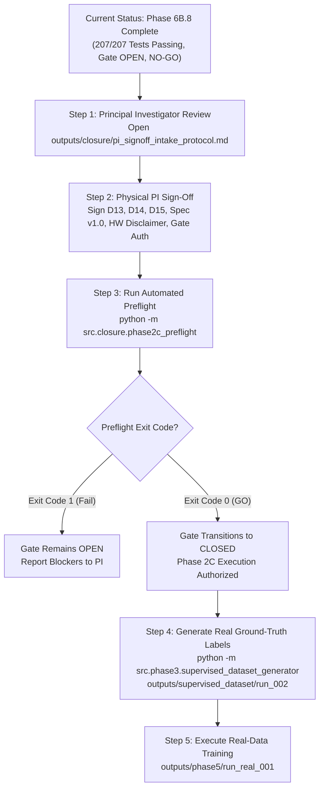

# FINAL GO / NO-GO GOVERNANCE DECISION REPORT
## Phase-Gated Authorization Determination Across All Project Dimensions

**Project:** *A Subject-Independent Kolmogorov-Arnold Network (KAN)-Based Framework for Non-Contact Heart-Rate Estimation from 120-GHz FMCW Radar Signals*  
**Repository Working Directory:** [`kan_radar_HR`](file:///c:/Users/admin/OneDrive/Desktop/KAN%20algrithm%20FRAME%20work/kan_radar_HR)  
**Determination Date:** October 2026  
**Audit Team:** Senior ML Research Engineer, Scientific Reproducibility Auditor, Research Governance Reviewer  
**Report Output Path:** [`outputs/closure/final_go_no_go_report.md`](file:///c:/Users/admin/OneDrive/Desktop/KAN%20algrithm%20FRAME%20work/kan_radar_HR/outputs/closure/final_go_no_go_report.md)  

---

## 1. Master Decision Matrix

The following table provides explicit, binding determinations across all five operational and scientific dimensions of the project:

| Project Dimension | Determination | Current Status | Responsible Party | Blocking Condition / Prerequisites |
| :--- | :---: | :---: | :---: | :--- |
| **1. Synthetic Benchmark Evaluation** | **`GO`** | **COMPLETE & VERIFIED** | Engineering Team | None. Synthetic benchmark is fully executed, reconciled, and audited across 8 subjects (207/207 tests passing). |
| **2. Phase 2A/2C Scientific Gate Closure** | **`NO-GO`** | **OPEN (FAIL-CLOSED)** | Principal Investigator | Pending physical review, option selection, and signature for Decisions D13, D14, D15, Label Spec v1.0, and HW Disclaimer. |
| **3. Real-Data Label Generation (`run_002`)** | **`NO-GO`** | **STRICTLY BLOCKED** | Principal Investigator | Blocked pending Dimension 2 (Gate Closure). Running `SupervisedDatasetGenerator` halts if approval file is absent. |
| **4. Real-Data Model Training (`run_real_001`)** | **`NO-GO`** | **STRICTLY BLOCKED** | Principal Investigator | Blocked pending Dimensions 2 & 3. Real radar signals cannot be used for weight optimization until labels are authorized. |
| **5. Clinical Deployment Readiness** | **`NO-GO`** | **OUT OF SCOPE** | Regulatory / Clinical | Academic prototype. Hardware clock unverified (`UNVERIFIED_HARDWARE_TIMING_NOMINAL_T0`). Not an FDA/CE cleared medical device. |

---

## 2. Detailed Dimension Determinations

### Dimension 1 — Synthetic Benchmark Evaluation: `GO`
- **Verdict:** **`GO` (Fully Approved & Completed)**
- **Evidence Base:**
  - Evaluated on 8 synthetic subjects (80 test windows) under strict Leave-One-Subject-Out (LOSO) cross-validation.
  - KAN demonstrated superior performance over comparative baselines:
    - KAN MAE: $2.592\text{ BPM}$ | RMSE: $4.144\text{ BPM}$ | Pearson $r: 0.8818$ | $\le \pm 10\text{ BPM}: 95.00\%$ (76/80 windows)
    - CNN MAE: $3.035\text{ BPM}$ | RMSE: $5.063\text{ BPM}$ | Pearson $r: 0.8027$ | $\le \pm 10\text{ BPM}: 88.75\%$ (71/80 windows)
    - MLP MAE: $3.365\text{ BPM}$ | RMSE: $4.606\text{ BPM}$ | Pearson $r: 0.8517$ | $\le \pm 10\text{ BPM}: 96.25\%$ (77/80 windows)
    - Mean Baseline MAE: $7.107\text{ BPM}$ (pooled error against training-fold mean; $11.834\text{ BPM}$ against global median)
  - Model parameters strictly reconciled: KAN (4,720 params), CNN (3,377 params), MLP (3,505 params), Mean (0 params).
  - All synthetic artifacts and prediction files are saved, hashed, and verified on disk.
  - Full metric reconciliation documented in [`outputs/closure/metric_discrepancy_reconciliation.md`](file:///c:/Users/admin/OneDrive/Desktop/KAN%20algrithm%20FRAME%20work/kan_radar_HR/outputs/closure/metric_discrepancy_reconciliation.md).

---

### Dimension 2 — Phase 2A/2C Scientific Gate Closure: `NO-GO`
- **Verdict:** **`NO-GO` (Gate Remains Strictly OPEN)**
- **Evidence Base:**
  - The baseline consistency audit [`outputs/phase2a/step2b_consistency_audit.md`](file:///c:/Users/admin/OneDrive/Desktop/KAN%20algrithm%20FRAME%20work/kan_radar_HR/outputs/phase2a/step2b_consistency_audit.md) formally documents:
    `Audit Status: PHASE 2A – STEP 2B STATUS: RECONCILIATION PARTIAL; ADDENDUM REQUIRED BEFORE FINALIZATION.`
  - The formal addendum [`outputs/closure/phase2a_reconciliation_addendum.md`](file:///c:/Users/admin/OneDrive/Desktop/KAN%20algrithm%20FRAME%20work/kan_radar_HR/outputs/closure/phase2a_reconciliation_addendum.md) tracks all 28 issues, but 7 issues remain open pending official PI review.
  - Automated governance validator [`src/closure/pi_signoff_validator.py`](file:///c:/Users/admin/OneDrive/Desktop/KAN%20algrithm%20FRAME%20work/kan_radar_HR/src/closure/pi_signoff_validator.py) confirms that official decision fields, approver names, signatures, and dates in [`outputs/closure/pi_signoff_intake_protocol.md`](file:///c:/Users/admin/OneDrive/Desktop/KAN%20algrithm%20FRAME%20work/kan_radar_HR/outputs/closure/pi_signoff_intake_protocol.md) are currently blank.
  - **Required Action to Achieve GO:** The Principal Investigator must physically sign Sections 2, 3, 4, 5, 6, and 7 of the intake protocol.

---

### Dimension 3 — Supervised Real-Data Ground-Truth Generation (`run_002`): `NO-GO`
- **Verdict:** **`NO-GO` (Strictly BLOCKED)**
- **Evidence Base:**
  - Target directory `outputs/supervised_dataset/run_002` does **not** exist (cryptographically verified).
  - In [`src/phase3/supervised_dataset_generator.py:137`](file:///c:/Users/admin/OneDrive/Desktop/KAN%20algrithm%20FRAME%20work/kan_radar_HR/src/phase3/supervised_dataset_generator.py#L137), `_verify_investigator_approval_guard()` halts with a `RuntimeError` if executed while the gate is open or if `investigator_decision.md` is absent.
  - The label specification [`outputs/closure/spec/label_spec_v1.json`](file:///c:/Users/admin/OneDrive/Desktop/KAN%20algrithm%20FRAME%20work/kan_radar_HR/outputs/closure/spec/label_spec_v1.json) has a frozen canonical hash (`ae5c67808b9ad8ae8f6e40f89434242e88a6de67b7d57d8478c6256075708f44`), but its `approved_by` field remains empty pending PI signature.
  - **Required Action to Achieve GO:** Formal gate closure (Dimension 2) must be signed. Once signed, `supervised_dataset_generator.py` can be safely executed with `--spec-sha256 ae5c6780...`.

---

### Dimension 4 — Real-Data Model Training (`run_real_001`): `NO-GO`
- **Verdict:** **`NO-GO` (Strictly BLOCKED)**
- **Evidence Base:**
  - Target directory `outputs/phase5/run_real_001` does **not** exist (cryptographically verified).
  - Model training on real radar signals requires ground-truth labels from Dimension 3 (`run_002`). Because Dimension 3 is blocked, training cannot legitimately begin.
  - Research integrity policy strictly forbids generating mock or fabricated real-model weights.
  - In [`src/demo/model_loader.py:176`](file:///c:/Users/admin/OneDrive/Desktop/KAN%20algrithm%20FRAME%20work/kan_radar_HR/src/demo/model_loader.py#L176), any attempt to load an unapproved real model checkpoint is halted by `check_scientific_gate_status()`.

---

### Dimension 5 — Clinical Deployment Readiness: `NO-GO`
- **Verdict:** **`NO-GO` (Out of Scope / Non-Clinical Prototype)**
- **Evidence Base:**
  - Hardware clock synchronization between the 120-GHz radar and the Mindray patient monitor is unverified. All software operations are bound to:
    `UNVERIFIED_HARDWARE_TIMING_NOMINAL_T0`.
  - The software has not undergone FDA/CE medical-device quality management (e.g. ISO 13485, IEC 62304) or clinical validation trials.
  - The interactive dashboard prominently displays research disclaimers indicating it is an offline research replay tool.

---

## 3. Transition Protocol & Operational Handoff

### Action Items & Responsible Owners:
1. **Principal Investigator (PI):**
   - Review [`outputs/closure/pi_signoff_intake_protocol.md`](file:///c:/Users/admin/OneDrive/Desktop/KAN%20algrithm%20FRAME%20work/kan_radar_HR/outputs/closure/pi_signoff_intake_protocol.md) and record official decisions and physical signatures.
   - Enter full name into `"approved_by"` field of [`outputs/closure/spec/label_spec_v1.json`](file:///c:/Users/admin/OneDrive/Desktop/KAN%20algrithm%20FRAME%20work/kan_radar_HR/outputs/closure/spec/label_spec_v1.json).
2. **Engineering Team:**
   - Execute `python -m src.closure.phase2c_preflight` to verify signed inputs.
   - Upon confirmed exit code 0 (`GO`), execute Phase 2C supervised dataset generation (`run_002`).
   - Audit generated `run_002` manifest before initiating Phase 5 real-data training.
