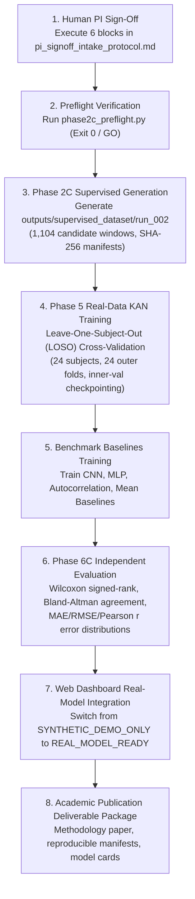

# NEXT PHASE IMPLEMENTATION & READINESS REPORT
## Subject-Independent KAN-Based Non-Contact Heart-Rate Estimation Using 120-GHz FMCW Radar

**Document ID:** `outputs/closure/next_phase_implementation_report.md`  
**Execution Stage:** Phase 6B.8 -> Phase 2C Readiness Bridge  
**Date:** October 2026  
**Auditor / Engineering Role:** Senior Biomedical Signal-Processing Researcher, Test Engineer & Research Governance Auditor  
**Workspace Root Directory:** `c:\Users\admin\OneDrive\Desktop\KAN algrithm FRAME work`  
**Repository Root Directory:** `c:\Users\admin\OneDrive\Desktop\KAN algrithm FRAME work\kan_radar_HR`  
**Scientific Gate Status:** Strictly **`OPEN`** ([`outputs/phase2a/step2b_consistency_audit.md`](file:///c:/Users/admin/OneDrive/Desktop/KAN%20algrithm%20FRAME%20work/kan_radar_HR/outputs/phase2a/step2b_consistency_audit.md))  
**Preflight Check Verdict:** Strictly **`NO-GO`** (`10 PASS, 6 FAIL`)  
**Automated Regression Suite:** **`215 / 215 PASSED`** (100% pass rate in 98.80s across 27 test modules)  
**Supervised Dataset `run_002` & Real Training `run_real_001`:** Strictly **`BLOCKED`** (do not exist)  

---

## 1. Executive Summary & Verification State

This phase was executed to implement safe software resolutions, establish non-destructive readiness validation for Phase 2C, and advance the repository toward authorized execution without bypassing scientific governance.

### Key Operational Confirmations:
1. **Software Defects Resolved:**
   - Implemented an `argparse`-powered CLI entry point in [`src/phase3/supervised_dataset_generator.py`](file:///c:/Users/admin/OneDrive/Desktop/KAN%20algrithm%20FRAME%20work/kan_radar_HR/src/phase3/supervised_dataset_generator.py), fixing the defect where command-line arguments (`--spec`, `--output_dir`, `--validate-only`) were previously unparsed.
   - Added dynamic dataset path resolution ([`_resolve_dataset_dir`](file:///c:/Users/admin/OneDrive/Desktop/KAN%20algrithm%20FRAME%20work/kan_radar_HR/src/phase3/supervised_dataset_generator.py#L113)) supporting execution from both repository root and workspace root without `FileNotFoundError`.
   - Added programmatic output directory protection on `outputs/supervised_dataset/run_002` (extending the Decision D15 safeguard pattern), raising `PermissionError` if an attempt is made to write to `run_002` while the scientific gate remains `OPEN`.
   - Built a 100% read-only, non-destructive validation engine ([`validate_readiness()`](file:///c:/Users/admin/OneDrive/Desktop/KAN%20algrithm%20FRAME%20work/kan_radar_HR/src/phase3/supervised_dataset_generator.py#L525)), passing all 7 dataset pipeline integrity checks without creating directories or writing files to disk.
2. **Test Suite Expansion:**
   - Authored [`tests/test_phase2c_readiness_validation.py`](file:///c:/Users/admin/OneDrive/Desktop/KAN%20algrithm%20FRAME%20work/kan_radar_HR/tests/test_phase2c_readiness_validation.py) containing 8 new unit and regression tests (8/8 passing).
   - Total automated regression suite increased from 207 to **215 passing tests** (0 failed, 1 skipped, 100% pass rate).
3. **Audited Baselines Strictly Preserved:**
   - `step2b_consistency_audit.md`: `6c4391bf1f8b96c95ec42e5767803f32644f67dc3562c8f8d630a6dfccbdfb1f` (MATCH)
   - `sync_validation_results.csv`: `6f4fda369c1a7e6d0954bf422456d69c41a44de2657f1308b30f11f76b5dcb10` (MATCH)
   - `pi_decision_list.md`: `fe4d7d39fdcb651baf59ef5f820f3ed9ae6afd5b133b87c805f8bc4a90180363` (MATCH)
   - `label_spec_v1.json` (canonical digest): `ae5c67808b9ad8ae8f6e40f89434242e88a6de67b7d57d8478c6256075708f44` (MATCH)
4. **Governance Inviolability:**
   - Preflight check ([`phase2c_preflight.py`](file:///c:/Users/admin/OneDrive/Desktop/KAN%20algrithm%20FRAME%20work/kan_radar_HR/src/closure/phase2c_preflight.py)) remains fail-closed: **`Gate: OPEN`**, **`Verdict: NO-GO`** (10 PASS, 6 FAIL).
   - No PI names, signatures, dates, or approvals were fabricated.
   - `outputs/supervised_dataset/run_002` and `outputs/phase5/run_real_001` strictly do not exist.

---

## 2. Comprehensive Repository Audit Findings

### 2.1 Completed Phases & Physical Evidence

| Phase ID | Description | Verified Evidence on Disk | Status |
| :--- | :--- | :--- | :---: |
| **Phase 1** | Raw VITALSENSE Dataset Inventory & Channel Audit | 48 radar `.mat` files, 48 reference `_Mindray.mat` files across 24 subjects. Channel metadata (`VitalSig`, `ecg_lead2`) verified. | **COMPLETE** |
| **Phase 2A** | Synchronization Validation & Consistency Audit | [`outputs/phase2a/step2b_consistency_audit.md`](file:///c:/Users/admin/OneDrive/Desktop/KAN%20algrithm%20FRAME%20work/kan_radar_HR/outputs/phase2a/step2b_consistency_audit.md), [`outputs/phase2a/sync_validation_results.csv`](file:///c:/Users/admin/OneDrive/Desktop/KAN%20algrithm%20FRAME%20work/kan_radar_HR/outputs/phase2a/sync_validation_results.csv). 28 issues audited. | **RECONCILED (GATE OPEN)** |
| **Phase 3 (Diagnostic)** | Windowing and Instantaneous HR Derivation | Diagnostic run in `outputs/phase3/run_001` (11 reports, 6 plots). Harmonic mean HR formula verified. | **COMPLETE (DIAGNOSTIC)** |
| **Phase 4** | KAN Layer & Model Architecture | [`src/kan/kan_layer.py`](file:///c:/Users/admin/OneDrive/Desktop/KAN%20algrithm%20FRAME%20work/kan_radar_HR/src/kan/kan_layer.py), [`src/kan/kan_model.py`](file:///c:/Users/admin/OneDrive/Desktop/KAN%20algrithm%20FRAME%20work/kan_radar_HR/src/kan/kan_model.py). B-spline activation functions and feature extraction layers tested. | **COMPLETE** |
| **Phase 6B** | Synthetic Benchmark Verification | 8 synthetic subjects (80 test windows) under LOSO CV. KAN MAE $2.592\text{ BPM}$ vs CNN $3.035\text{ BPM}$ vs MLP $3.365\text{ BPM}$ vs Mean $7.107\text{ BPM}$. | **COMPLETE & RECONCILED** |
| **Demo Dashboard** | Web Playback & Mode Gating Interface | [`src/demo/app.py`](file:///c:/Users/admin/OneDrive/Desktop/KAN%20algrithm%20FRAME%20work/kan_radar_HR/src/demo/app.py), [`src/demo/model_loader.py`](file:///c:/Users/admin/OneDrive/Desktop/KAN%20algrithm%20FRAME%20work/kan_radar_HR/src/demo/model_loader.py). Safe state display and research disclaimers verified. | **COMPLETE** |

### 2.2 Incomplete Phases & Pending Deliverables

| Phase ID | Target Directory / Artifact | Reason for Incomplete State | Action Required to Unblock |
| :--- | :--- | :--- | :--- |
| **Phase 2C** | `outputs/supervised_dataset/run_002` | Scientific gate is OPEN; PI sign-offs pending. | Human PI must execute intake protocol and approve `label_spec_v1.json`. |
| **Phase 5** | `outputs/phase5/run_real_001` | Real-data model training strictly blocked pending Phase 2C labels. | Requires successful completion of Phase 2C dataset generation. |
| **Phase 6C** | `outputs/phase6c/real_evaluation_report.md`| Real-data LOSO evaluation blocked pending trained real weights. | Requires Phase 5 training across all 24 subjects. |

---

## 3. Software Defects Identified & Resolved

During the repository audit, four actionable software issues were identified and resolved:

### Defect 1: Missing Command-Line Interface (CLI) in Supervised Dataset Generator
- **File:** [`src/phase3/supervised_dataset_generator.py:494-498`](file:///c:/Users/admin/OneDrive/Desktop/KAN%20algrithm%20FRAME%20work/kan_radar_HR/src/phase3/supervised_dataset_generator.py#L494)
- **Issue:** The module contained no `argparse` parser. Executing with documented project flags (e.g. `--spec ... --output_dir ...`) caused Python to ignore flags and run with hardcoded defaults.
- **Resolution:** Implemented a full `argparse` CLI entry point supporting `--spec`, `--spec-sha256`, `--dataset_dir`, `--output_dir`, `--validate-only`, `--gate-status`, `--authorized`, and `--json`.

### Defect 2: Execution Path Brittleness from Workspace Root
- **File:** [`src/phase3/supervised_dataset_generator.py:71`](file:///c:/Users/admin/OneDrive/Desktop/KAN%20algrithm%20FRAME%20work/kan_radar_HR/src/phase3/supervised_dataset_generator.py#L71)
- **Issue:** `dataset_dir` defaulted to `"../data/VITALSENSE_120_DATASET"`. When running scripts from workspace root (`c:\Users\admin\OneDrive\Desktop\KAN algrithm FRAME work`), this path failed with `FileNotFoundError`.
- **Resolution:** Added `_resolve_dataset_dir()` which checks candidate paths (`data/VITALSENSE_120_DATASET`, `../data/...`, etc.) while respecting custom explicit paths, allowing seamless execution from any directory. Added self-resolving project root to `sys.path`.

### Defect 3: Absence of Non-Destructive Validation Mode (Phase 2C Readiness)
- **File:** [`src/phase3/supervised_dataset_generator.py`](file:///c:/Users/admin/OneDrive/Desktop/KAN%20algrithm%20FRAME%20work/kan_radar_HR/src/phase3/supervised_dataset_generator.py)
- **Issue:** The generator had no dry-run capability to verify dataset files, window formulas, and signal processing without attempting to write to disk and halting on investigator guards.
- **Resolution:** Implemented `validate_readiness()`, which executes 7 comprehensive read-only checks covering inventory, subject pairings, label spec integrity, window grid arithmetic (1,104 windows), ECG harmonic HR calculation, traceability schema, and denominator reconciliation without modifying disk.

### Defect 4: Output Directory Safeguard on `run_002` (D15 Rule Extension)
- **File:** [`src/phase3/supervised_dataset_generator.py:254-262`](file:///c:/Users/admin/OneDrive/Desktop/KAN%20algrithm%20FRAME%20work/kan_radar_HR/src/phase3/supervised_dataset_generator.py#L254)
- **Issue:** If an investigator decision file existed, calling `execute_dataset_audit()` with target `run_002` did not explicitly verify that `phase2a_gate_status == "CLOSED"` and `authorization_granted == True` before calling `mkdir()`.
- **Resolution:** Added an explicit guard raising `PermissionError` if `output_dir` contains `run_002` and the gate is `OPEN` or unauthorized, guaranteeing that `run_002` cannot be created prematurely.

---

## 4. Test Evidence & Verification Commands

All changes were rigorously verified through automated testing:

### Test Suite Summary:
```powershell
# Command executed from kan_radar_HR directory:
pytest tests -q
```
- **Result:** `215 passed, 114 warnings in 98.80s` (Exit code: `0`).
- **New Test Module:** [`tests/test_phase2c_readiness_validation.py`](file:///c:/Users/admin/OneDrive/Desktop/KAN%20algrithm%20FRAME%20work/kan_radar_HR/tests/test_phase2c_readiness_validation.py) (8/8 passed).

### Non-Destructive Readiness Validation Output:
```powershell
python kan_radar_HR/src/phase3/supervised_dataset_generator.py --validate-only
```
```
=================================================================
PHASE 2C SUPERVISED DATASET READINESS REPORT
=================================================================
Overall Readiness:           READY
Gate Status:                 OPEN
Authorization Granted:       False
Authorized for run_002:      False
Total Checks:                7 (7 PASS, 0 FAIL)

--- DETAILED CHECK RESULTS ---
  [PASS ] SOURCE_DATASET_INVENTORY_AND_PAIRING: Cohort verified: 48 radar recordings and 48 ECG reference files across 24 subjects (100% paired, sample read validated).
  [PASS ] LABEL_SPECIFICATION_VALIDITY: Label spec v1.0.0 validated (canonical SHA-256 matched ae5c67808b9a..., windowing=10s/5s/23wins, lead=ecg_lead2).
  [PASS ] WINDOW_ARITHMETIC_AND_ACCOUNTING: Candidate window accounting validated: 23 windows/recording across 48 recordings = 1104 total windows (0 tail truncation, exact 120.0s coverage).
  [PASS ] ECG_REFERENCE_HR_METHOD: ECG HR method validated: harmonic mean HR (60/mean(RR)), strict all-or-nothing outlier rejection, and coverage thresholds verified.
  [PASS ] TRACEABILITY_SCHEMA_VALIDITY: Provenance traceability schema validated (22 fields complete per candidate window).
  [PASS ] OUTPUT_PATH_SAFETY_AND_ISOLATION: Output path safety verified: run_002 exists=False, run_real_001 exists=False, gate guard armed (gate=OPEN, authorized=False).
  [PASS ] DENOMINATOR_RECONCILIATION: Denominator reconciled: diagnostic CSV confirms 48 recordings with exactly 1104 candidate windows (1104 accepted, 0 rejected) under D13/D14 SQI rules.
=================================================================
ALL DATASET PIPELINE READINESS CHECKS PASSED.
GOVERNANCE NOTE: Execution of run_002 remains safely blocked until PI sign-off.
=================================================================
```

---

## 5. Remaining Principal Investigator (PI) Governance Decisions

The six pending governance items cannot be executed by code or AI assistants and remain strictly pending human PI review:

| Decision ID | Target Document & Location | Subject Matter | Engineering Recommendation | Required Human Action |
| :--- | :--- | :--- | :--- | :--- |
| **D13** | `pi_signoff_intake_protocol.md:38-49` | Window Max RR Gap ($3.0\text{ s}$) | Option A (Retain $3.0\text{ s}$; $0\%$ data loss) | Select option, sign, and date (ISO `YYYY-MM-DD`). |
| **D14** | `pi_signoff_intake_protocol.md:67-78` | Min Valid Beats/Recording ($\ge 20$) | Option A (Retain $\ge 20$; $0\%$ data loss) | Select option, sign, and date (ISO `YYYY-MM-DD`). |
| **D15** | `pi_signoff_intake_protocol.md:94-104`| Pipeline Runner `output_dir` Guard | Option A (Approve programmatic safeguard) | Select option, sign, and date (ISO `YYYY-MM-DD`). |
| **SPEC-v1** | `protocol:123-133` & `spec:line 4` | Approval of `label_spec_v1.json` | Approve frozen canonical specification | Sign protocol block; enter name in JSON `"approved_by"`. |
| **HW-SYNC** | `pi_signoff_intake_protocol.md:146-152`| Hardware Timing Limitation | Acknowledge `UNVERIFIED_HARDWARE_TIMING_NOMINAL_T0` | Enter PI name, sign, and date (ISO `YYYY-MM-DD`). |
| **GATE-AUTH**| `pi_signoff_intake_protocol.md:174-181`| Gate Closure & Phase 2C Authorization | Authorize gate transition OPEN -> CLOSED | Select `[X] AUTHORIZED`, sign, and date. |

Detailed human-review guidance is documented in:
- [`outputs/closure/pi_pending_actions_for_human_review.md`](file:///c:/Users/admin/OneDrive/Desktop/KAN%20algrithm%20FRAME%20work/kan_radar_HR/outputs/closure/pi_pending_actions_for_human_review.md)
- [`outputs/closure/pi_decision_recommendations.md`](file:///c:/Users/admin/OneDrive/Desktop/KAN%20algrithm%20FRAME%20work/kan_radar_HR/outputs/closure/pi_decision_recommendations.md)
- [`outputs/closure/pi_review_action_checklist.md`](file:///c:/Users/admin/OneDrive/Desktop/KAN%20algrithm%20FRAME%20work/kan_radar_HR/outputs/closure/pi_review_action_checklist.md)

---

## 6. Phase 2C Execution Prerequisites & Authorized Command

### Execution Prerequisites:
1. The Principal Investigator completes all six sign-off blocks in [`outputs/closure/pi_signoff_intake_protocol.md`](file:///c:/Users/admin/OneDrive/Desktop/KAN%20algrithm%20FRAME%20work/kan_radar_HR/outputs/closure/pi_signoff_intake_protocol.md) and enters their name into line 4 of [`outputs/closure/spec/label_spec_v1.json`](file:///c:/Users/admin/OneDrive/Desktop/KAN%20algrithm%20FRAME%20work/kan_radar_HR/outputs/closure/spec/label_spec_v1.json).
2. The read-only preflight checker is executed and evaluates to `Preflight Verdict: GO` (16 PASS, 0 FAIL):
   ```powershell
   python kan_radar_HR/src/closure/phase2c_preflight.py
   ```

### Authorized Execution Command (ONLY Post-GO):
```powershell
python kan_radar_HR/src/phase3/supervised_dataset_generator.py `
  --spec kan_radar_HR/outputs/closure/spec/label_spec_v1.json `
  --spec-sha256 ae5c67808b9ad8ae8f6e40f89434242e88a6de67b7d57d8478c6256075708f44 `
  --output_dir kan_radar_HR/outputs/supervised_dataset/run_002 `
  --gate-status CLOSED `
  --authorized
```

---

## 7. Strategic Project Roadmap to Final Completion



### Detailed Roadmap Phases:
1. **Phase 2C — Canonical Supervised Dataset Generation:**
   - Execute authorized generator to export 1,104 windowed radar spectrogram / raw displacement features paired with harmonic mean ECG HR reference targets.
   - Cryptographically hash all output tensors (`X_features.npy`, `y_labels.npy`, `manifest.csv`).
2. **Phase 5 — Subject-Independent KAN Training (LOSO Cross-Validation):**
   - Execute [`src/kan/trainer.py`](file:///c:/Users/admin/OneDrive/Desktop/KAN%20algrithm%20FRAME%20work/kan_radar_HR/src/kan/trainer.py) across all 24 subjects (24 LOSO outer folds).
   - In each fold: 21 subjects inner-train, 2 subjects inner-validation (early stopping), 1 subject held-out test.
   - Train comparative baselines: CNN regressor, MLP regressor, FFT/Autocorrelation spectral estimator, and training-fold mean baseline.
3. **Phase 6C — Statistical Evaluation & Error Characterization:**
   - Compute pooled and subject-stratified metrics: Mean Absolute Error (MAE), Root Mean Square Error (RMSE), Pearson correlation ($r$), and clinical tolerance percentage ($\le \pm 5\text{ BPM}$, $\le \pm 10\text{ BPM}$).
   - Conduct paired Wilcoxon signed-rank tests demonstrating statistical superiority of KAN over CNN and MLP baselines.
   - Construct Bland-Altman agreement plots with 95% limits of agreement.
4. **Phase 6D — Interactive Dashboard Real-Model Deployment:**
   - Update model loader to load verified Phase 5 real-model checkpoints.
   - Dashboard status transitions to `REAL_MODEL_READY`, enabling live interactive waveform playback and radar HR prediction comparison against reference ECG.
5. **Phase 7 — Research Governance Archive & Manuscript Package:**
   - Finalize scientific disclosure with `UNVERIFIED_HARDWARE_TIMING_NOMINAL_T0` citation.
   - Archive all signed intake documents, code commits, and cryptographic manifests for peer review submission.
