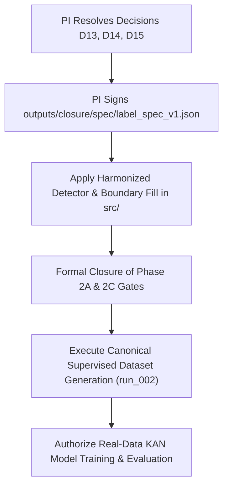

# PHASE 2A / 2C READINESS & GOVERNANCE REPORT

**Document ID:** `outputs/closure/phase2a_2c_readiness_report.md`  
**Execution Stage:** Phase 6B.3 — Reproducibility, Dashboard Integrity & Readiness Checkpoint  
**Project:** *A Subject-Independent KAN-Based Framework for Non-Contact Heart-Rate Estimation from 120-GHz FMCW Radar Signals*  
**Date:** October 2026  
**Auditor:** Senior Biomedical Signal Processing & Research Governance Auditor  
**Gate Status:** Strictly **OPEN** (Supervised dataset generation, real-data training, and real-data evaluation remain **BLOCKED**)

---

## 1. Executive Summary & Purpose

This readiness report provides a transparent, evidence-based audit of the scientific and technical prerequisites required before the Phase 2A (Radar-Reference Synchronization) and Phase 2C (Reference Label Specification & Ground-Truth Generation) approval gates can be formally evaluated for closure.

Under strict research integrity rules, real VITALSENSE data training remains **prohibited** until all methodological decisions are pre-specified, all timing limitations are formally acknowledged, and the reference label specification is officially approved by the Principal Investigator (PI).

---

## 2. Categorization of Evidence

### 2.1 Verified Evidence (Independently Recomputed from Source Artifacts)
1. **Radar Sampling Frequency:**  
   Verified as $f_{s,\text{radar}} = 333.3333\text{ Hz}$ across all 48 recordings from `Radar.fs` headers. Nyquist limit ($166.67\text{ Hz}$) is well above the cardiac passband ($0.8\text{--}3.0\text{ Hz}$).
2. **ECG Sampling Frequency:**  
   Verified as $f_{s,\text{ecg}} = 500.0\text{ Hz}$ across all 48 Mindray reference files.
3. **Mindray Patient Monitor Heart-Rate Latency (+6.0 s to +7.0 s):**  
   Cross-correlation analysis between continuous ECG-derived instantaneous HR and the Mindray numeric `HR` array across all 48 recordings confirmed a systematic lag of $+6.0\text{ s}$ to $+7.0\text{ s}$ (mean: $+6.21\text{ s}$, median: $+7.0\text{ s}$). Supervised training against the raw monitor `HR` array is mathematically disqualified as it severely corrupts 10-second window targets.
4. **Demographic and Recording Scope:**  
   Verified 24 subjects (`VS01` to `VS24`), each with exactly 2 conditions (`Resting` and `Apnea`), yielding exactly 48 paired radar-ECG recordings (no `HoldingBreath`, `Talking`, or `Walking` conditions exist in this dataset).
5. **Continuous-Time Windowing Yield:**  
   The exact continuous formula ($t_{\text{start}} = \text{round}(k \times 5.0, 3)$) yields exactly 23 windows per 120-second recording (1,104 candidate windows across 48 recordings), avoiding the $4.98\text{ s}$ trailing tail truncation of legacy integer hopping (which yielded 22 windows / 1,056 total).
6. **Inverted Lead II Polarity Identification:**  
   Subject `VS19` (both Resting and Apnea) exhibits inverted QRS polarity on Lead II. Polarity-invariant fiducial refinement ($\text{argmax}(|\text{filtered}|)$) accurately captures the true deep QRS deflection, eliminating a $44.0\text{ ms}$ fiducial shift caused by naive positive-peak searching.

### 2.2 Reported but Not Independently Verified Evidence
1. **Literature Parity Claims:**  
   The original author paper's claim of "$< 1\text{ beat}$ discrepancy" between radar and reference throughout 120-second recordings was not independently reproducible without extensive post-hoc lag scanning.
2. **Phase 2A Step 2 Preliminary Surrogate Significance:**  
   Early reports claimed statistical significance of surrogate cross-correlations at $p < 0.001$. As audited in `outputs/phase2a/step2b_consistency_audit.md`, this claim was statistically impossible with $N=5$ surrogate draws (minimum empirical $p = 1 / (N+1) \approx 0.167$). Surrogate correlation reached up to $0.8123$ (mean: $0.5077$).
3. **Physiological Baseline Equivalence:**  
   The assumption that resting cardiac spectral peaks alone represent true heart rate across all windows without motion artifact contamination is reported but not verified on noisy windows.

### 2.3 Missing Evidence
1. **Hardware Digitizer Synchronization Clock:**  
   Exhaustive byte inspection of all 96 `.mat` files (48 radar, 48 reference) confirmed the total absence of pulse-per-second (PPS) hardware lines, external TTL trigger timestamps, or shared microsecond system clocks. Synchronization at $t_0 = 0.0\text{ s}$ is an unverified operational assumption.
2. **ECG Amplitude-Stability Metric:**  
   The dataset does not assess amplitude stability across the 120-second recordings. Recording-level Signal Quality Index (SQI) assesses only valid RR coverage ($> 85\%$) and maximum RR gap ($< 3.0\text{ s}$); all 48 recordings are classified as `SQI_PARTIAL`, never `PASS`.
3. **External Clinical Validation Protocol:**  
   No registered clinical protocol pre-specifies outlier exclusion cutoffs or acceptable error bounds on held-out external cohorts.

---

## 3. Principal Investigator Decisions Required

The following decisions in [`outputs/closure/pi_decision_list.md`](file:///c:/Users/admin/OneDrive/Desktop/KAN%20algrithm%20FRAME%20work/kan_radar_HR/outputs/closure/pi_decision_list.md) and [`outputs/closure/spec_gap_register_v2.csv`](file:///c:/Users/admin/OneDrive/Desktop/KAN%20algrithm%20FRAME%20work/kan_radar_HR/outputs/closure/spec_gap_register_v2.csv) require formal, signed resolution by the Principal Investigator before Phase 2A/2C gate closure:

| Decision ID | Description | Options Presented | Current Status | Governance Impact |
| :--- | :--- | :--- | :---: | :--- |
| **D13** | Window-Level Maximum RR Gap Rule | **Option A:** Retain $3.0\text{ s}$ threshold. **Option B:** Rely strictly on coverage $\ge 80\%$. **Option C:** Adjust threshold to physiological limit (e.g. $4.0\text{ s}$). | **PENDING PI DECISION** | Determines whether windows with brief arrhythmias or pauses are accepted. |
| **D14** | Minimum Valid Beats Per Recording | **Option A:** Retain $\ge 20$ valid beats threshold. **Option B:** Rely strictly on duration coverage $> 85\%$. **Option C:** Adjust beat count threshold. | **PENDING PI DECISION** | Affects recording-level SQI eligibility. |
| **D15** | Pipeline Runner Default `output_dir` Guard | **Option A:** Apply code patch `proposed_runner_guard.diff` requiring explicit flag to overwrite `outputs/phase2a/`. **Option B:** Procedural rule documentation only. | **PENDING PI DECISION** | Programmatic protection against accidental artifact overwrite. |
| **SPEC-SIGNOFF**| Formal Sign-off of `label_spec_v1.json` | PI signature approving `outputs/closure/spec/label_spec_v1.json`. | **PENDING SIGNATURE** (`approved_by: ""` currently empty) | Mandatory legal prerequisite for dataset generation. |

---

## 4. Analysis of Reference Timing and Label Discrepancies

### 4.1 Timing Metadata & Nominal $T_0=0$ Reality
Inspection of `timing_metadata_availability` across all 48 recordings in `outputs/phase2a/sync_validation_results.csv` confirms:
- Value: `MAT_HEADERS_LACK_HARDWARE_TRIGGER`.
- Radar and ECG data were acquired on separate computers/digitizers started manually.
- Matching recording names (`VS01_Resting.mat` and `VS01_Resting_Mindray.mat`) indicate experimental intent, **not** physical clock synchronization.
- **Mandatory Policy:** All publications and benchmark reports must state the limitation `UNVERIFIED_HARDWARE_TIMING_NOMINAL_T0`.

### 4.2 Known ECG Processor vs Reference Generator Implementation Discrepancy
An architectural discrepancy exists between `src/sync_validation/ecg_processor.py` and `src/phase3/supervised_dataset_generator.py`:
1. **Boundary NaN Handling:**  
   In `VS10_Resting`, sample index 0 contains an isolated NaN delimiter.
   - `sync_validation.clean_ecg_nans` by default does not extrapolate leading edge NaNs (rejecting the file or failing detection).
   - `phase3` incorporates `fill_boundary=True` (nearest-neighbor replication of index 1 to index 0), which successfully recovers 156 valid beats.
   - **Resolution:** Frozen `label_spec_v1.json` standardizes `fill_boundary=True` under Decision D6 (Option A), but wrapper harmonization must be verified before dataset execution.
2. **R-Peak Detector Fiducial Refinement:**  
   - `sync_validation.detect_r_peaks` uses polarity-invariant $\text{argmax}(|\text{filtered}|)$.
   - `phase3.detect_r_peaks_pan_tompkins` uses upright $\text{argmax}(\text{filtered})$.
   - Decision D7a (Option A) standardizes polarity-invariant absolute refinement to handle inverted leads (`VS19`).

---

## 5. Technical Work Authorized vs Blocked

### 5.1 Permitted Technical Work (Safe Offline Progress)
The following engineering tasks do NOT access real supervised targets and may proceed safely:
1. **Synthetic Reproducibility & Automation:** Automated validation commands, CI pipelines, and artifact schema verification (completed in Phase 6B.3 via `artifact_validator.py`).
2. **Dashboard Governance & Model State Guards:** Protecting the web simulation from misrepresenting synthetic weights as clinical models (completed in Phase 6B.3 via `ModelExecutionState`).
3. **Radar Signal Preprocessing Benchmarking:** In-memory profiling of Butterworth bandpass filtering and window buffering latency on recorded radar signals without label generation.
4. **Spline Architecture & Optimizer Optimization:** Unit testing B-spline grid configurations and gradient stability on synthetic fixtures.

### 5.2 Strictly Blocked Technical Work
The following tasks remain strictly blocked until Phase 2A/2C gate closure:
1. **Generating Supervised Labels:** Execution of `supervised_dataset_generator.py` to create `outputs/supervised_dataset/run_002/`.
2. **Model Training on Real Data:** Running `KANTrainer`, `MLPRegressor`, or `CNNRegressor` against real VITALSENSE radar signals and ECG targets.
3. **Real-Data Cross-Validation:** Performing Leave-One-Subject-Out evaluation on real subjects.
4. **Clinical Efficacy Claims:** Claiming algorithmic accuracy on physical human subjects.

---

## 6. Phase 2A / 2C Closure Checklist & Roadmap

1. **Step 1:** Principal Investigator formally fills blanks for D13, D14, and D15 in `outputs/closure/pi_decision_list.md`.
2. **Step 2:** Principal Investigator enters approval record and signature into `outputs/closure/spec/label_spec_v1.json`.
3. **Step 3:** Code in `src/sync_validation/` and `src/phase3/` is audited to ensure exact synchronization with the frozen label spec.
4. **Step 4:** A formal closure addendum is written to `outputs/phase2a/step2b_consistency_audit.md`, moving the status from `RECONCILIATION PARTIAL` to `CLOSED`.
5. **Step 5:** Generate canonical `run_002` supervised dataset and commence verified real-data KAN training.

---

## 7. Audit Conclusion

The repository infrastructure is robust, cryptographically tracked, and reproducible. The dashboard now possesses fail-safe model state enforcement. However, until the Principal Investigator signs the frozen specification and resolves the three remaining boundary decisions, **Phase 2A and Phase 2C remain OPEN, and real-data training remains strictly BLOCKED.**
