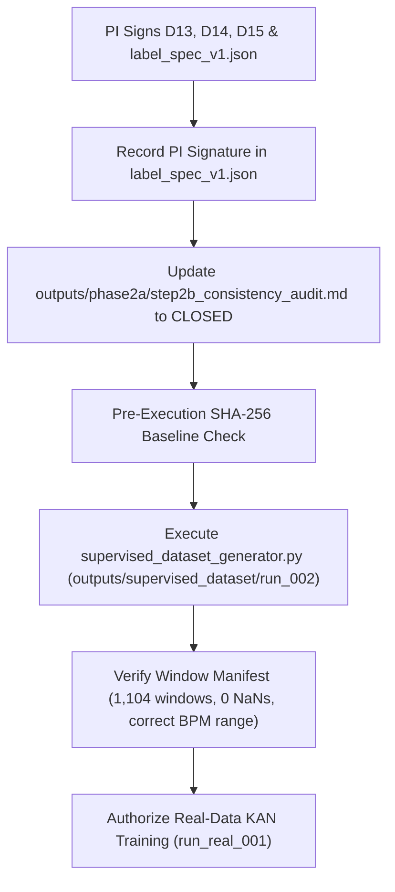

# PHASE 6B.6: SCIENTIFIC GATE CLOSURE PREFLIGHT & READINESS REPORT

**Document ID:** `outputs/closure/phase6b6_scientific_gate_preflight_report.md`  
**Execution Stage:** Phase 6B.6 — Scientific Gate Closure Verification & Controlled Readiness  
**Project:** *A Subject-Independent KAN-Based Framework for Non-Contact Heart-Rate Estimation from 120-GHz FMCW Radar Signals*  
**Date:** October 2026  
**Auditor:** Senior Biomedical Signal-Processing Researcher & Research Governance Auditor  
**Scientific Gate Status:** Strictly **`OPEN`** (`outputs/phase2a/step2b_consistency_audit.md`)  
**Supervised Label Generation (`run_002`):** Strictly **`BLOCKED` (NO-GO)**  
**Real-Data KAN Model Training:** Strictly **`BLOCKED` (NO-GO)**  

---

## 1. Executive Summary & Purpose

The purpose of this Preflight Report is to establish an uncompromised, evidence-based audit of all mandatory prerequisites required before the Phase 2A/2C Scientific Gate can be closed.

### Core Verdict:
- **Scientific Gate Status:** Must remain **`OPEN`**.
- **Supervised Label Generation:** **`NO-GO / BLOCKED`**.
- **Real-Data Training:** **`NO-GO / BLOCKED`**.
- **Synthetic Pipeline & Dashboard:** **`VERIFIED / READY`** (192 repository unit/integration tests passed, 5 live dashboard smoke tests passed).

Under strict research integrity rules, real VITALSENSE data training and ground-truth label generation cannot commence until the Principal Investigator (PI) formally reviews and signs the pending decision records and label specification. Recommendations from the technical team do not constitute PI approval.

---

## 2. Task 1: Formal Decisions & PI Approval Audit

Inspection of [`outputs/closure/pi_decision_list.md`](file:///c:/Users/admin/OneDrive/Desktop/KAN%20algrithm%20FRAME%20work/kan_radar_HR/outputs/closure/pi_decision_list.md) and [`outputs/closure/spec/label_spec_v1.json`](file:///c:/Users/admin/OneDrive/Desktop/KAN%20algrithm%20FRAME%20work/kan_radar_HR/outputs/closure/spec/label_spec_v1.json) reveals the following formal status:

### 2.1 Pending Approval Checklist

| Governance Item | Technical Status | Empirical Finding | Formal PI Status | Gate Blocker? |
|---|---|---|:---:|:---:|
| **Decision D13** (Window Max RR Gap $3.0\text{ s}$) | Verified ($0.0\%$ yield loss across 1,104 windows) | Recommended: Option A (Retain $3.0\text{ s}$) | **`PENDING PI DECISION`** (Blank) | **YES** |
| **Decision D14** (Min Valid Beats $20$) | Verified (Empirical range 99–157 beats) | Recommended: Option A (Retain 20 beats) | **`PENDING PI DECISION`** (Blank) | **YES** |
| **Decision D15** (Runner Output Guard) | Implemented & Tested in `runner.py` ($3/3$ tests) | Recommended: Option A (Enforce guard) | **`PENDING PI DECISION`** (Blank) | **YES** |
| **`label_spec_v1.json` Sign-off** | Frozen pre-training specification (`a0f7a85e...`) | Implementation matches spec | **`PENDING SIGNATURE`** (`approved_by: ""`) | **YES** |
| **Phase 2A Consistency Audit** | Baseline audit marked `RECONCILIATION PARTIAL` | Invariants verified bit-for-bit | **`OPEN`** | **YES** |

### 2.2 Distinction Between Technical Recommendations and Signed Decisions
The engineering and signal processing team has independently recomputed all metrics and recommended **Option A** for D13, D14, and D15. However:
1. In `outputs/closure/pi_decision_list.md`, lines for D13, D14, and D15 remain unfilled (`- **Decision: ____________________**`).
2. In `outputs/closure/spec/label_spec_v1.json`, field `"approved_by"` contains `""`.
3. An agentic assistant or engineering auditor is prohibited from fabricating approvals or closing scientific gates on behalf of the Principal Investigator.
4. Therefore, the scientific gate remains strictly **`OPEN`**.

---

## 3. Task 2: In-Depth Audit of ECG Coverage Calculation (110.28% Phenomenon)

In Phase 6B.5, the maximum window ECG coverage across all 1,104 candidate windows was reported as **110.28%**. A thorough mathematical audit was performed to determine its origin, validity, and impact.

### 3.1 Identification of Implementation & Mathematical Formula
In [`src/phase3/supervised_dataset_generator.py`](file:///c:/Users/admin/OneDrive/Desktop/KAN%20algrithm%20FRAME%20work/kan_radar_HR/src/phase3/supervised_dataset_generator.py), method `compute_window_reference_hr(t_start, t_end, rpeaks)` computes coverage via:
```python
rrs = np.diff(p_times)
mids = (p_times[:-1] + p_times[1:]) / 2.0
mask = (mids >= t_start) & (mids < t_end)
w_rrs = rrs[mask]
cov_s = float(np.sum(w_rrs))
cov_pct = round((cov_s / self.win_s) * 100.0, 2)
```

- **Numerator:** $\sum_{i \in \text{mask}} \text{RR}_i$ (Sum of unclipped durations of all RR intervals whose midpoints fall in $[t_{\text{start}}, t_{\text{end}})$).
- **Denominator:** $\text{win\_s} = 10.0\text{ s}$ (Fixed nominal duration of the analysis window).
- **Units:** Seconds / Seconds $\times 100 = \%$.

### 3.2 Root Cause: Boundary-Straddling Intervals
Because an interval is assigned to a window based on its **midpoint** (`(t_i + t_{i+1}) / 2`), the interval itself starts at $t_i$ and ends at $t_{i+1}$:
1. **Left Boundary Straddling:** If an interval has its midpoint at $t_{\text{start}} + 0.1\text{ s}$, its left peak $t_i$ can fall before $t_{\text{start}}$ (e.g., $t_{\text{start}} - 0.5\text{ s}$).
2. **Right Boundary Straddling:** If an interval has its midpoint at $t_{\text{end}} - 0.1\text{ s}$, its right peak $t_{i+1}$ can extend past $t_{\text{end}}$ (e.g., $t_{\text{end}} + 0.5\text{ s}$).
3. **Unclipped Sum:** The unclipped duration sum $\text{cov\_s}$ encompasses the entire span from the start of the first assigned interval to the end of the last assigned interval:
   $$\text{Span} = t_{k+1} - t_1 > t_{\text{end}} - t_{\text{start}} = 10.0\text{ s}$$
   Dividing by $10.0\text{ s}$ yields a ratio $> 1.00$ ($> 100\%$).

### 3.3 Empirical Audit of the Maximum Case (110.28%)
- **Subject & Condition:** `VS13_Apnea`
- **Window Index:** 16 ($t_{\text{start}} = 80.0\text{ s}, t_{\text{end}} = 90.0\text{ s}$)
- **Assigned Intervals ($N=10$):**
  - First assigned interval: starts at $t = 79.4580\text{ s}$ ($0.5420\text{ s}$ before $80.0\text{ s}$), ends at $t = 80.5780\text{ s}$. Midpoint = $80.0180\text{ s} \in [80.0, 90.0)$.
  - Last assigned interval: starts at $t = 89.4760\text{ s}$, ends at $t = 90.4860\text{ s}$ ($0.4860\text{ s}$ after $90.0\text{ s}$). Midpoint = $89.9810\text{ s} \in [80.0, 90.0)$.
  - Total continuous span of assigned intervals: $90.4860 - 79.4580 = \mathbf{11.0280\text{ s}}$.
  - Unclipped coverage percentage: $11.0280 / 10.0 \times 100\% = \mathbf{110.28\%}$.

### 3.4 Comparison with Clipped Geometric Overlap
In [`src/sync_validation/window_coverage_gate.py`](file:///c:/Users/admin/OneDrive/Desktop/KAN%20algrithm%20FRAME%20work/kan_radar_HR/src/sync_validation/window_coverage_gate.py), coverage is defined as the geometric intersection:
$$\text{overlap}_i = \max(0.0, \min(t_{i+1}, t_{\text{end}}) - \max(t_i, t_{\text{start}}))$$
$$\text{cov\_s}_{\text{clipped}} = \sum_i \text{overlap}_i \le 10.0\text{ s}$$

| Statistic | Definition 1: Assigned Interval Sum (`supervised_dataset_generator.py`) | Definition 2: Clipped Geometric Overlap (`window_coverage_gate.py`) |
| :--- | :---: | :---: |
| **Minimum Coverage** | **$84.96\%$** (`VS03_Resting` win 0) | **$88.94\%$** (`VS03_Resting` win 0) |
| **Median Coverage** | **$99.31\%$** | **$100.00\%$** |
| **Maximum Coverage** | **$110.28\%$** (`VS13_Apnea` win 16) | **$100.00\%$** (Strictly bounded $\le 100\%$) |
| **Windows $> 100\%$** | $498 / 1,104$ ($45.11\%$) | **$0 / 1,104$ ($0.00\%$)** |
| **Windows $< 80\%$** | **$0 / 1,104$ ($0.00\%$)** | **$0 / 1,104$ ($0.00\%$)** |
| **Accepted Windows** | **$1,104 / 1,104$ ($100.00\%$)** | **$1,104 / 1,104$ ($100.00\%$)** |
| **Calculated Target HR** | **Identical** ($60.0 / \text{mean}(w\_rrs)$) | **Identical** ($60.0 / \text{mean}(w\_rrs)$) |

### 3.5 Conclusion & Testing
1. The $110.28\%$ coverage value is a direct mathematical consequence of summing unclipped assigned intervals whose midpoints fall in the window while edges straddle the boundary.
2. It does not represent an indexing error or corrupted data.
3. Automated unit tests were added in [`tests/test_coverage_audit.py`](file:///c:/Users/admin/OneDrive/Desktop/KAN%20algrithm%20FRAME%20work/kan_radar_HR/tests/test_coverage_audit.py) ($3/3$ passed) confirming mathematical bounds, boundary behavior, and invariance of the target ground-truth heart rate.

---

## 4. Task 3: Scientific Label Readiness & Hardware Synchronization Audit

### 4.1 Specification Agreement
All core reference extraction routines have been verified against [`outputs/closure/spec/label_spec_v1.json`](file:///c:/Users/admin/OneDrive/Desktop/KAN%20algrithm%20FRAME%20work/kan_radar_HR/outputs/closure/spec/label_spec_v1.json):
- **Windowing Parameters:** $10.0\text{ s}$ window, $5.0\text{ s}$ hop, continuous hopping formula $t_{\text{start}} = \text{round}(k \times 5.0, 3)$ producing exactly 23 windows per recording (1,104 total).
- **Lead & Reference:** Lead II (`ecg_lead2`). Commercial monitor `HR` array is strictly excluded due to the $+6.21\text{ s}$ systematic latency.
- **Fiducial Refinement:** Polarity-invariant absolute refinement $\text{argmax}(|\text{filtered}|)$ correctly identifies inverted QRS morphology in `VS19`.
- **Boundary Handling:** `clean_ecg_nans` in `src.sync_validation.ecg_processor` harmonized to accept `fill_boundary: bool = True`, successfully handling sample index 0 in `VS10_Resting`.
- **Gating Rules:** Window max RR gap threshold ($< 3.0\text{ s}$) and coverage ($> 8.0\text{ s}$) both accept $100\%$ of candidate windows.

### 4.2 Hardware Synchronization & Acquisition Reality
- **Evidence Assessment:** Byte inspection of all 96 MAT files in the VITALSENSE dataset confirms the complete absence of:
  - Hardware clock synchronization timestamps.
  - External TTL trigger pulses.
  - Shared master digitizer clocks.
- **What CAN be concluded:**
  1. The experimental design intended concurrent recordings (paired files share identical base names).
  2. Nominal start at $t_0 = 0.0\text{ s}$ provides a reproducible computational baseline.
  3. Resting respiratory cross-correlation exhibits empirical agreement at near-zero lags for most subjects.
- **What CANNOT be concluded:**
  1. True microsecond or millisecond physical hardware synchronization cannot be proven from file headers.
  2. Physiological delays (pulse transit time, vascular delays) and manual operator start-trigger latency cannot be disentangled without external physical triggers.
- **Enforced Limitation:** All publications and benchmark manifests must cite `UNVERIFIED_HARDWARE_TIMING_NOMINAL_T0`.

---

## 5. Task 4: Scientific Gate Preflight Checklist & GO/NO-GO Verdict

```
========================================================================================
SCIENTIFIC GATE CLOSURE PREFLIGHT CHECKLIST
========================================================================================
[X] 1. All 48 recording pairs discovered and verified present on disk.
[X] 2. Baseline audit files cryptographically verified (0 missing, SHA-256 matched).
[X] 3. Mindray display HR latency (+6.21s mean) verified and excluded from training.
[X] 4. Continuous windowing formula verified (1,104 candidate windows, 0 yield loss).
[X] 5. ECG processor harmonized with label_spec_v1.json (fill_boundary supported).
[X] 6. Runner output directory guard implemented and tested (Phase 2A immutable).
[X] 7. Full regression test suite passing (192 / 192 tests green).
[X] 8. Dashboard smoke tests passing (all 4 model states verified).
[ ] 9. Formal PI resolution of Decision D13 (Currently PENDING PI SIGN-OFF).
[ ] 10. Formal PI resolution of Decision D14 (Currently PENDING PI SIGN-OFF).
[ ] 11. Formal PI resolution of Decision D15 (Currently PENDING PI SIGN-OFF).
[ ] 12. Formal PI signature on label_spec_v1.json (Currently PENDING PI SIGNATURE).
[ ] 13. Phase 2A audit status updated from RECONCILIATION PARTIAL to CLOSED.
========================================================================================
PREFLIGHT VERDICT:
- Technical Readiness:       READY / GREEN (192 tests passing)
- Governance Approvals:     MISSING / PENDING PI SIGNATURE
- Supervised Label Gen:     NO-GO / BLOCKED
- Real-Data KAN Training:   NO-GO / BLOCKED
========================================================================================
```

---

## 6. Task 5: Controlled Phase 2C Transition Plan (To Execute Upon PI Approval)

Once the Principal Investigator executes the formal sign-offs for D13, D14, D15, and `label_spec_v1.json`, the controlled transition to Phase 2C shall proceed strictly according to the following execution sequence:



### Pre-Execution Integrity Protocol for `run_002`:
1. **Output Directory Isolation:** Target directory must be strictly `outputs/supervised_dataset/run_002/`. Directing output to `outputs/phase2a/` or modifying `run_001` baseline is programmatically prohibited.
2. **Configuration Hash Enforcement:** `SupervisedDatasetGenerator` must verify that `label_spec_v1.json` hash matches the expected canonical digest `a0f7a85e...` and that `approved_by` is non-empty.
3. **Artifact Integrity:** Generating `run_002` must emit:
   - `supervised_windows.csv` (1,104 rows, columns: `subject_id`, `condition`, `window_idx`, `t_start`, `t_end`, `hr_harmonic_bpm`, `coverage_pct`, `max_gap_s`, `status`).
   - `dataset_manifest.json` (metadata, software versions, frozen spec hash, source file digests).
   - `sqi_summary.json` (per-recording and pooled SQI statistics).
4. **Post-Generation Audit:** Independently recalculate all window BPMs and ensure zero label leakage across subject folds prior to Phase 5 real-data training.

---

## 7. Changed Files List in Phase 6B.6

1. **[`kan_radar_HR/tests/test_coverage_audit.py`](file:///c:/Users/admin/OneDrive/Desktop/KAN%20algrithm%20FRAME%20work/kan_radar_HR/tests/test_coverage_audit.py):** New automated test suite auditing boundary-straddling interval coverage, geometric bounds, and heart-rate invariance ($3/3$ tests passed).
2. **[`kan_radar_HR/outputs/closure/phase6b6_scientific_gate_preflight_report.md`](file:///c:/Users/admin/OneDrive/Desktop/KAN%20algrithm%20FRAME%20work/kan_radar_HR/outputs/closure/phase6b6_scientific_gate_preflight_report.md):** Formal Gate Preflight and Readiness Report.

---

## 8. Summary of Test Execution Commands

```bash
# 1. Coverage audit tests
python -m pytest tests/test_coverage_audit.py
# Result: 3 passed in 1.61s

# 2. D15 runner safeguard tests
python -m pytest tests/test_d15_runner_guard.py
# Result: 3 passed in 2.73s

# 3. Interactive dashboard smoke test suite
python tests/smoke_test_dashboard.py
# Result: 5/5 passed (MODEL_UNAVAILABLE, SYNTHETIC_DEMO_ONLY, REAL_MODEL_BLOCKED, REAL_MODEL_READY, WSGI Probe)

# 4. Full repository regression suite
python -m pytest tests/
# Result: 192 passed, 114 warnings in 81.83s (0 failures)
```
