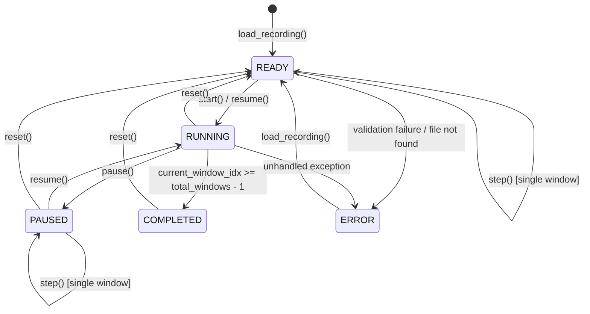

# PHASE 8 DEMO SIMULATION ARCHITECTURE & SYSTEM DESIGN

**Project Title:** A Subject-Independent KAN-Based Framework for Non-Contact Heart-Rate Estimation from 120-GHz FMCW Radar Signals  
**Execution Stage:** Phase 8 — Recorded Radar Data Streaming Simulation  
**Document:** System Architecture & Interface Specification  
**Run Directory:** `outputs/demo_simulation/run_001/`  
**Execution Date:** 2026-10-18  

---

## 1. Executive Summary & Purpose

The Phase 8 Demo Simulation implements a high-fidelity, deterministic software playback environment for 120-GHz FMCW radar data recorded in the VITALSENSE study. The primary objective is to demonstrate the operational pipeline:

$$\mathbf{Recorded\ Radar\ MAT} \longrightarrow \mathbf{Streaming\ Buffer} \longrightarrow \mathbf{Rolling\ Window\ (10s)} \longrightarrow \mathbf{Validated\ Preprocessing} \longrightarrow \mathbf{Gated\ Inference\ Engine} \longrightarrow \mathbf{Interactive\ Dashboard}$$

### Mandatory Governance Constraints
1. **Recorded Data Replay Only:** The application explicitly simulates streaming from recorded `.mat` files. It never claims physical 120-GHz hardware connectivity.
2. **Phase 2A Gate Open:** The governance gate remains strictly `OPEN` (`outputs/phase2a/step2b_consistency_audit.md`). No real-data training or supervised tensor export is performed.
3. **Zero Fabrication:** In the absence of an authorized, trained KAN checkpoint, the system operates in **Mode A: Visualization Only**. Heart rate estimates are displayed as `NOT AVAILABLE` / `null`. No randomized or synthetic BPM values are ever presented as radar predictions.

---

## 2. System Architecture Overview

The system is organized into modular decoupled tiers adhering strictly to existing project conventions:

```
+-----------------------------------------------------------------------------------+
|                           USER INTERFACES                                         |
|  +-------------------------------------+  +------------------------------------+  |
|  |     Interactive Web Dashboard       |  |       Headless Terminal CLI        |  |
|  |  (HTML5 / Canvas / Vanilla JS SPA)  |  |      (src/demo/cli.py runner)      |  |
|  +-------------------------------------+  +------------------------------------+  |
+------------------------------------------+----------------------------------------+
                                           | REST / In-Process API
+------------------------------------------v----------------------------------------+
|                      FLASK REST APPLICATION SERVICE                               |
|                         (src/demo/app.py)                                         |
|  - Endpoints: /, /api/status, /api/recordings, /api/select,                      |
|               /api/control, /api/state, /api/history, /api/export                |
|  - Concurrency: Background playback worker thread + threading.Lock()              |
+------------------------------------------+----------------------------------------+
                                           | Thread-Safe Method Calls
+------------------------------------------v----------------------------------------+
|                     RADAR SIMULATION PLAYBACK ENGINE                              |
|                   (src/demo/simulation_engine.py)                                 |
|  - Virtual Clock Management (0.5x, 1.0x, 2.0x speeds)                            |
|  - Continuous Buffer & Rolling Window Segmentation (10s win, 5s hop)              |
|  - State Machine: READY -> RUNNING <-> PAUSED -> COMPLETED / ERROR                |
|  - Session Export: Structured JSON metadata & CSV history logging                 |
+---------------------+---------------------------------------+---------------------+
                      |                                       |
+---------------------v-----------------+  +------------------v---------------------+
|      DATA LOADING & PREPROCESSING     |  |       SAFE MODEL INFERENCE ENGINE      |
|  - RobustMatLoader (src.phase3)       |  |       (src/demo/model_loader.py)       |
|    Strict v5/v7 MAT validation        |  |  - Zero-Fabrication Guard              |
|  - RadarPreprocessor (src.phase3)     |  |  - Strict Checkpoint Verification      |
|    Bandpass 0.8-3.0 Hz (zero-phase)   |  |  - Mode A: VISUALIZATION_ONLY          |
|    Nyquist validation & finiteness    |  |  - Mode B: SAVED_MODEL_INFERENCE       |
+---------------------------------------+  +----------------------------------------+
```

---

## 3. Core Component Breakdown

### 3.1 RadarSimulationEngine (`src/demo/simulation_engine.py`)
Responsible for managing playback state, virtual time progression, window slicing, and session logging:
- **`discover_recordings()`**: Traverses `dataset_dir` recursively, filtering for radar `.mat` files (excluding Mindray references), returning subject and condition metadata for all 48 recordings.
- **`load_recording(file_path)`**: Loads raw samples using `RobustMatLoader`, verifies radar sampling frequency ($f_s \approx 333.3333\text{ Hz}$), computes bandpass-filtered signal, resets state machine, and isolates session history.
- **`advance_time(delta_sim_s)`**: Increments virtual elapsed simulation time, advancing sample pointers deterministically without drift.
- **`step()`**: Advances directly to the next complete 10-second window ($3,333$ samples), updates window pointers, invokes `SafeModelInferenceEngine`, and records history.
- **`get_snapshot()`**: Generates an immutable, thread-safe `SimulationSnapshot` containing current sample, window index, playback state, signal quality, and model status.
- **`export_session_logs(output_dir)`**: Persists structured session metadata (`.json`) and granular window-level records (`.csv`).

### 3.2 SafeModelInferenceEngine (`src/demo/model_loader.py`)
Provides strict gating around ML model inference:
- **`get_compatibility_status()`**: Validates checkpoint existence, weights integrity, architecture compatibility, and governance status. If absent, explicitly declares `operating_mode = "VISUALIZATION_ONLY"`.
- **`predict_window(window_signal, ...)`**: Validates window length ($N = 3,333$) and sample finiteness. If model is unavailable, strictly returns `ModelInferenceResult(status="MODEL_UNAVAILABLE", prediction_bpm=None)`.
- **Zero Training Guarantee**: Inference executes within `with tf.device('/CPU:0'):` without gradient tapes or optimizer steps, ensuring zero weight modification during demo runtime.

### 3.3 Data Ingestion & Signal Quality (`src/phase3/mat_loader.py` & `preprocessor.py`)
Direct reuse of validated Phase 3 components:
- **`RobustMatLoader`**: Inspects binary header (MATLAB v5/v7.3), extracts `VitalSig`, parses `Radar.fs` or `1/T_frame`, computes finiteness metrics (`finite_count`, `nan_count`, `inf_count`), and prevents silent padding.
- **`RadarPreprocessor`**: Applies a 3rd-order Butterworth bandpass filter ($0.8\text{--}3.0\text{ Hz}$, corresponding to $48\text{--}180\text{ BPM}$) using zero-phase bidirectional filtering (`scipy.signal.filtfilt`).

---

## 4. State Machine & Lifecycle Transitions

The replay engine is governed by a deterministic finite state machine (FSM):



### State Definitions
| State | Behavior & Trigger | Window Progression |
|---|---|---|
| `READY` | File loaded and validated; pointers at sample 0, window -1. | Idle |
| `RUNNING` | Virtual clock advancing via background worker thread or CLI loop. | Automatic upon reaching window boundary |
| `PAUSED` | Virtual clock halted; user can inspect current window or manually step. | Halted |
| `COMPLETED` | Final complete window ($K = 21$, total 22 windows) processed; trailing tail preserved. | Halted |
| `ERROR` | Data loading failure, corrupted MAT, or missing variable detected. | Halted |

---

## 5. Thread Safety & Concurrency Model

In the Flask web server (`src/demo/app.py`):
1. **Background Playback Worker:** A persistent daemon thread runs at a fixed interval ($\Delta t_{\text{tick}} \approx 50\text{ ms}$). It computes wall-clock elapsed time, scales it by `simulation_speed` ($0.5\times$, $1.0\times$, $2.0\times$), and calls `engine.advance_time(sim_dt)`.
2. **Mutex Protection (`threading.Lock()`):** Every operation modifying or reading engine state (`advance_time`, `step`, `pause`, `resume`, `reset`, `load_recording`, `get_snapshot`, `export_session_logs`) is protected by a shared re-entrant lock (`playback_lock`).
3. **Race Condition Prevention:** HTTP GET requests (`/api/state`, `/api/history`) acquire the lock to construct serialized snapshots, guaranteeing that canvas renders and metric cards are mutually consistent.

---

## 6. REST API Interface Contracts

All endpoints return JSON responses with standard HTTP status codes:

### 6.1 `GET /api/status`
Returns system governance, operating mode, and active hardware disclaimers.
```json
{
  "project_title": "Subject-Independent KAN FMCW Radar HR Estimation",
  "phase": "Phase 8 — Recorded Radar Data Streaming Simulation",
  "simulation_mode": "VISUALIZATION_ONLY",
  "governance_gate": "OPEN (outputs/phase2a/step2b_consistency_audit.md)",
  "hardware_disclaimer": "RECORDED DATA SIMULATION — HARDWARE CLOCK UNVERIFIED — NOT CLINICAL SOFTWARE",
  "model_name": "KANRegressor",
  "model_available": false,
  "model_status_reason": "No trained KAN checkpoint found in repository (Phase 2A Gate OPEN: real-data training not authorized)",
  "session_id": "demo_sess_20261018_054520"
}
```

### 6.2 `GET /api/recordings`
Lists all 48 available VITALSENSE recordings.
```json
{
  "count": 48,
  "current_selected": "VS01_Resting",
  "recordings": [
    {
      "recording_id": "VS01_Resting",
      "subject_id": "VS01",
      "condition": "Resting",
      "file_name": "VS01_Resting.mat",
      "file_path": ".../data/VITALSENSE_120_DATASET/VS01/VS01_Resting.mat",
      "file_size_bytes": 320456
    }
  ]
}
```

### 6.3 `POST /api/select`
Loads a selected recording and resets simulation pointers.
- **Request:** `{"recording_id": "VS02_Apnea"}`
- **Response:** `{"success": true, "recording_id": "VS02_Apnea", "total_windows": 22, "fs_hz": 333.3333}`

### 6.4 `POST /api/control`
Executes playback commands.
- **Request:** `{"action": "start" | "pause" | "resume" | "reset" | "step" | "speed", "speed": 1.0}`
- **Response:** `{"success": true, "action": "step", "playback_state": "PAUSED", "current_window_idx": 0}`

### 6.5 `GET /api/state`
Returns real-time simulation snapshot and downsampled waveform for UI canvas rendering.
- **Response:**
```json
{
  "snapshot": {
    "recording_id": "VS01_Resting",
    "playback_state": "RUNNING",
    "elapsed_sim_time_s": 15.2,
    "current_window_idx": 2,
    "processed_window_count": 3,
    "latest_hr_bpm": null,
    "signal_quality_status": "VALID_FINITE_SIGNAL"
  },
  "waveform": {
    "times_s": [0.0, 0.03, ...],
    "raw_amplitudes": [0.12, 0.15, ...],
    "filtered_amplitudes": [0.05, 0.08, ...],
    "total_points": 500,
    "current_time_s": 15.2,
    "window_start_s": 10.0,
    "window_end_s": 20.0
  }
}
```

### 6.6 `GET /api/history`
Returns chronological array of all processed window audit records.

### 6.7 `POST /api/export`
Flushes session metadata and window history to disk in `outputs/demo_simulation/run_001/`.

---

## 7. User Interface Design & Visual Safeguards

The single-page application (`src/demo/templates/index.html`, `static/app.css`, `static/app.js`) is engineered with zero external CDN dependencies:
1. **Mandatory Disclaimer Banners:** Two top-level alert banners prominently communicate:
   - `RECORDED DATA — SIMULATION MODE`: Replay of recorded VITALSENSE data; no live 120-GHz radar attached.
   - `RESEARCH PROTOTYPE — NOT CLINICAL SOFTWARE`: Unverified hardware timing nominal $T_0$; Phase 2A gate OPEN.
2. **Dual Synchronized HTML5 Canvases:**
   - **Waveform Canvas:** Plots both raw and bandpass-filtered radar signals with an active 10-second window cursor sliding along the temporal axis.
   - **Heart Rate Canvas:** Plots the temporal trajectory of HR estimates (and displays a prominent `MODEL UNAVAILABLE (MODE A)` watermark when predictions are disabled).
3. **Session Audit Table:** Displays exact sample indices, time ranges, SQI status, and model inference results for every completed window.
